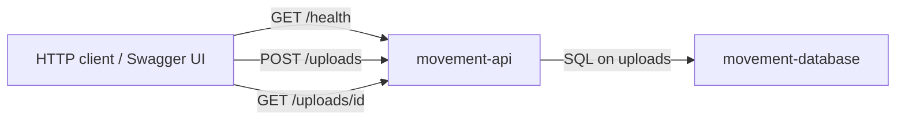

# v0.0.0 — API and database only

Current movement-analysis runtime: two Compose services, no object storage, queue, workers, cache, load balancer, or auth.

- **movement-api** — ASP.NET Core 10 (`MovementAnalysis.Api`). Npgsql to Postgres. Endpoints: `GET /health` (`SELECT 1`), `POST /uploads` (insert dummy squat/`uploaded`/`dummy/{id}.mp4`), `GET /uploads/{id}`. Swagger UI for calling them.
- **movement-database** — PostgreSQL 18. Named volume `postgres_data`. First boot runs `db/init.sql` (`uploads` table).

