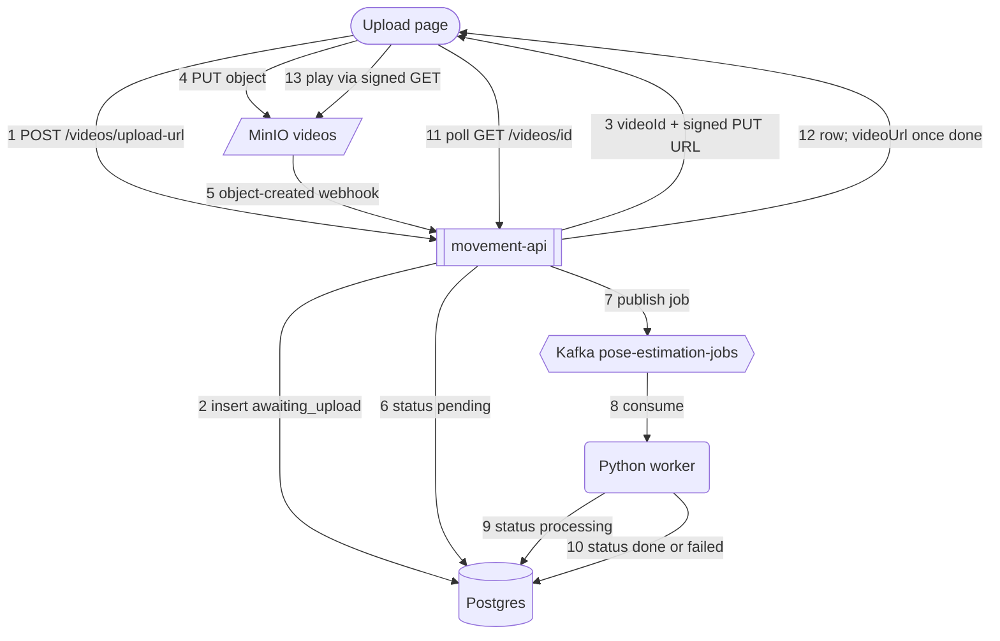

# v0.1.0 — Upload page, presigned upload, MinIO webhook, Kafka, worker skeleton

The browser never sends video bytes through the API. It asks the API for a short-lived PUT URL, uploads straight to MinIO, then polls status until the worker is done. MinIO tells the API the file landed; the API queues a Kafka job; the worker writes `processing` then `done` (or `failed`) to Postgres. Pose estimation is still a stub (`process_video` logs the job and sleeps 3 seconds).

Run and failure behavior: [movement-analysis/README.md](../../movement-analysis/README.md).

## Services

| Service | Role in this version |
| --- | --- |
| **movement-api** | Serves the upload page (`GET /upload` → `/upload.html`). `POST /videos/upload-url` creates the row and a signed PUT URL. `POST /webhooks/minio/object-created` sets `pending` and publishes the Kafka job. `GET /videos/{id}` returns status, plus a signed GET `videoUrl` once `done`. `GET /health` checks Postgres and MinIO (not Kafka). |
| **movement-storage** | MinIO bucket `videos`. On object PUT it POSTs an S3-style event to the API webhook (`MINIO_NOTIFY_WEBHOOK_*`, wired by `movement-storage-init`). Default CORS allows the browser PUT from `localhost:8080` to `127.0.0.1:9000`. |
| **movement-kafka** | KRaft broker. Init container creates topic `pose-estimation-jobs` (1 partition). |
| **movement-worker** | Python consumer (`pose-estimation-worker`). Opens a Postgres connection per job, writes `processing` then `done`/`failed`, commits the Kafka offset only after that. Handles SIGTERM so `docker stop` leaves the group immediately. `restart: unless-stopped`. |
| **movement-database** | Postgres 18, `uploads` table. Statuses used in 0.1.0: `awaiting_upload` → `pending` → `processing` → `done` or `failed`. Enum also has leftover `uploaded` / `queued` from 0.0.0; nothing writes them. |

## Happy-path diagram

Every arrow is a numbered step. Steps 11–13 start as soon as the PUT returns (step 4) and keep going until the row is `done` or `failed`.

## Steps

**1. Request an upload URL** — the page calls `POST /videos/upload-url` with `{ "fileName": "IMG_3141.mov", "movementType": "squat" }`. `movementType` is optional and defaults to `squat`; the only other allowed value is `high_kick`. A missing `fileName` or any other movement type returns 400. Directories are stripped from `fileName` (`../../etc/x.mov` → `x.mov`).

**2. Insert `awaiting_upload`** — the API generates a `videoId` (and a placeholder `userId` until auth exists). Object key is `{videoId}/{fileName}`. It inserts that key into `uploads` with status `awaiting_upload`. The id is server-generated so the webhook can match the object back to the row, and so clients cannot pick or collide ids.

**3. Return the signed PUT URL** — signing is local (AWS SDK, no call to MinIO). The URL is valid for that one key, PUT only, 15 minutes, HTTP (local MinIO has no TLS). Response: `videoId`, `presignedUrl`. In Development it also returns `uploadCommand` (a curl you can run by hand). The page fills **Get upload link**.

**4. PUT the file to MinIO** — the page PUTs the file body to `presignedUrl` with `XMLHttpRequest` so it can show upload percent and MB. Bytes go to MinIO on port 9000, not through the API. MinIO checks the signature and expiry. A changed signature, a different key, or the wrong verb (GET with a PUT URL) is 403 and the row stays `awaiting_upload`. On 2xx the page fills **Upload to storage**.

**5. Object-created webhook** — MinIO POSTs an S3 event to `POST /webhooks/minio/object-created` (`Records[0].s3.object.key`). The API URL-decodes the key (`+` is a space). Bad JSON, empty bodies, and events with no key still return 200 so MinIO does not retry forever; they do nothing else.

**6. Status `pending`** — one statement: `UPDATE uploads SET status = 'pending' WHERE video_object_key = @key AND status = 'awaiting_upload' RETURNING id, movement_type`. No matching row means unknown key, duplicate event, or a re-upload to the same URL (the row already moved on); those return 200 and stop. The status check in `WHERE` means two racing deliveries cannot both win.

**7. Publish the Kafka job** — the winner of step 6 publishes `{ videoId, storageKey, exerciseType }` to `pose-estimation-jobs`, keyed by `videoId`. `Acks.All`: `ProduceAsync` returns only once the broker has stored the message. Known gap: if this publish fails after step 6, the row stays `pending` and no job is ever sent.

**8. Worker consumes** — `movement-worker` (group `pose-estimation-worker`) reads the message. Malformed payloads (not JSON, no `videoId`) are logged as `skip malformed job` and skipped; the worker stays up. Offsets are committed only after the job is handled, so a crash mid-job is redelivered instead of lost.

**9. Status `processing`** — the worker opens a fresh Postgres connection and `UPDATE … SET status = 'processing' WHERE id = … AND status = 'pending'`. If that updates nothing (duplicate or already handled), it skips. Otherwise it calls `process_video()` (log + 3s sleep). The page's next poll fills **Analyzing**.

**10. Status `done` or `failed`** — on success, `UPDATE … SET status = 'done' WHERE status = 'processing'`. If `process_video()` raises, the worker logs the exception and sets `failed` instead. Then it commits the Kafka offset.

**11. Poll status** — after the PUT (step 4), the page calls `GET /videos/{videoId}` every second for up to 2 minutes. A brief API outage is ignored and polling continues. Mapping:

| `status` | Stepper |
| --- | --- |
| `awaiting_upload` | Queued, "waiting for storage" |
| `pending` | Queued, "waiting for a worker" |
| `processing` | Analyzing |
| `done` | Results |
| `failed` | Analyzing turns red |

**12. Poll response** — JSON is the `uploads` row (`id`, `userId`, `movementType`, `videoObjectKey`, `status`, timestamps). When `status` is `done`, the API also signs a GET URL for the same key (15 minutes, HTTP) and returns it as `videoUrl`. Otherwise `videoUrl` is null.

**13. Play the video** — the page sets `<video src="{videoUrl}">` and a download link (iPhone HEVC `.mov` often plays in Safari and not Chrome). That GET goes to MinIO, same as the upload: signed, path-style, not proxied through the API.

## Known gaps

These leave a row stuck; the page sits on Queued or Analyzing until the 2-minute poll timeout.

- **Step 7 fails after step 6** — row stays `pending`, no Kafka job.
- **Step 5 never reaches the API** (API down, or 5xx) — MinIO does not retry unless `MINIO_NOTIFY_WEBHOOK_QUEUE_DIR` is set, and it is not. File is stored; row stays `awaiting_upload`.
- **Worker dies during step 9–10** — redelivered job is skipped because the row is no longer `pending`; it stays `processing`.
- **First API request after a Postgres restart** — can 500 (dead pooled connection). The next request works.

Worker stop/start, API blip during poll, Postgres down when a job arrives, duplicate webhook, and bad request bodies: [When things go wrong](../../movement-analysis/README.md#when-things-go-wrong).
