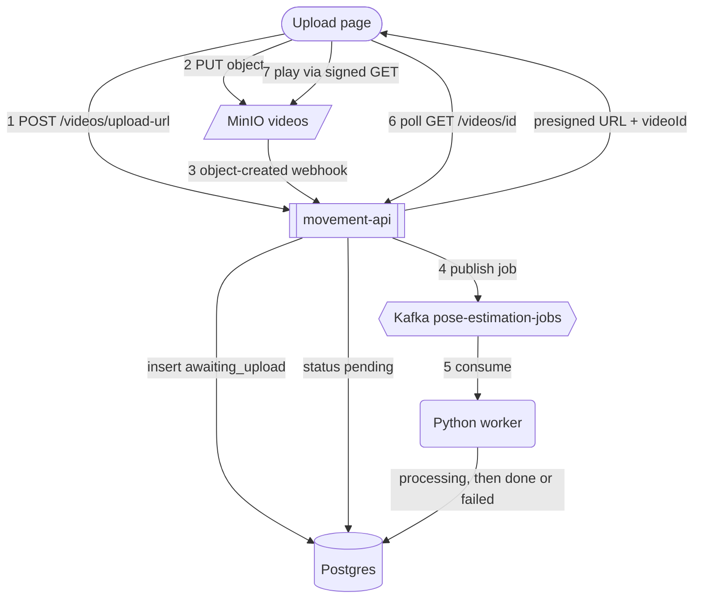

# v0.1.0 — Upload page, presigned upload, MinIO webhook, Kafka, worker skeleton

The upload page asks the API for a URL, PUTs the file straight to MinIO, MinIO notifies the API, the API publishes a Kafka job, and the Python worker marks the upload `processing` then `done`. The page polls status and plays the video when it's done. No pose estimation yet.

- **movement-api** — `GET /upload` (upload page), `POST /videos/upload-url`, `POST /webhooks/minio/object-created`, `GET /videos/{id}`, `GET /health`.
- **movement-storage** — MinIO bucket `videos`; webhook on object create.
- **movement-kafka** — KRaft, topic `pose-estimation-jobs`.
- **movement-worker** — Python consumer, stub `process_video()`, writes status to Postgres.
- **movement-database** — `uploads` statuses `awaiting_upload` → `pending` → `processing` → `done` / `failed`.

